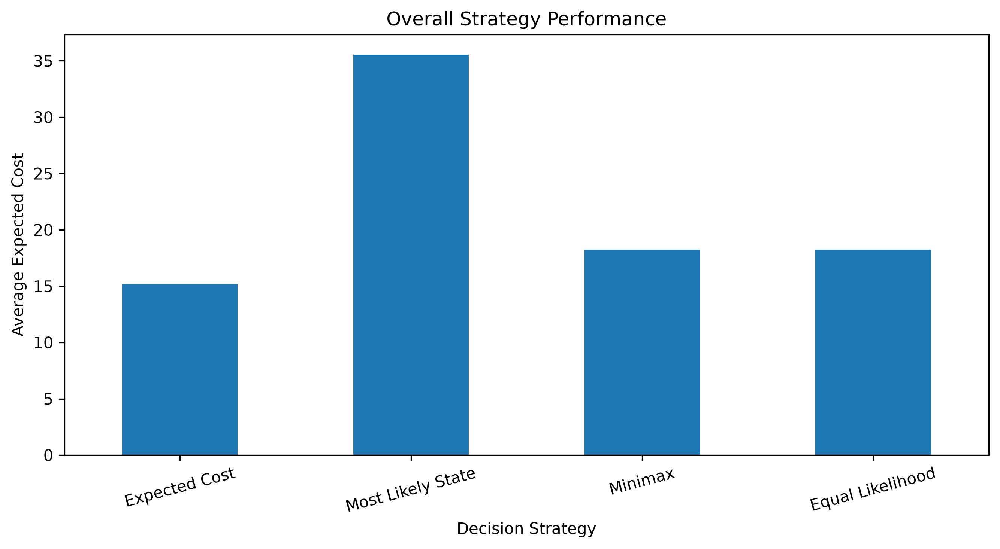
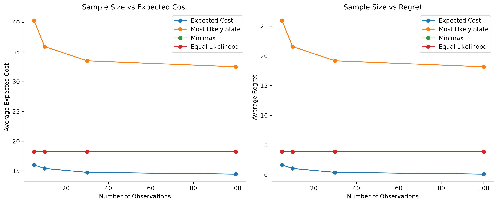
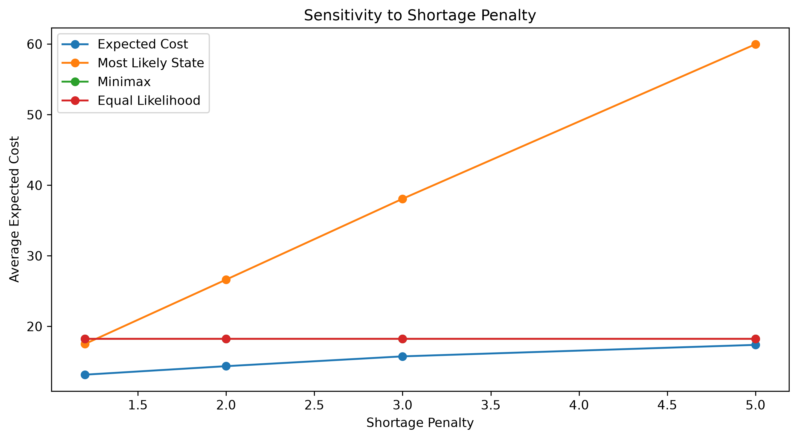
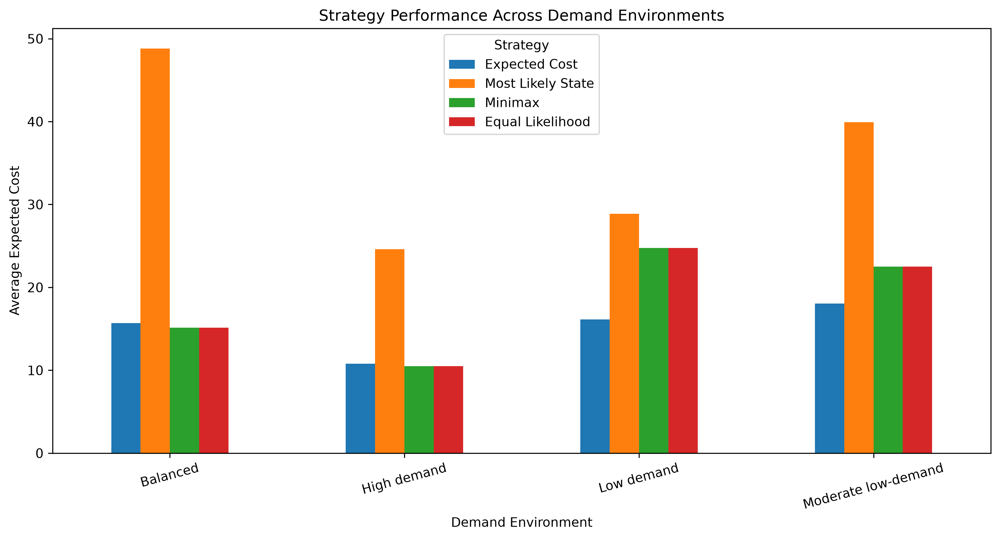

# Simulation-Based Comparative Evaluation of Probabilistic Decision-Making Strategies Under Limited Information
 
## Overview
 
This project presents a simulation-based comparison of decision-making strategies under limited information.
 
The study considers a decision-maker who must select an appropriate capacity before actual demand is known. Decisions are made using limited historical observations, while the true demand distribution is unknown to the decision-maker.
 
The objective is to evaluate how different decision strategies perform across varying demand environments, shortage penalties, and sample sizes.
 
## Research Objective
 
The experiment investigates:
 
- How effectively do probabilistic decision-making strategies minimize expected cost?
- How does the amount of available information affect decision quality?
- How sensitive are strategy outcomes to changes in shortage penalties?
- How do strategies perform under different demand distributions?
## Mathematical Model
 
### Decision and demand states
 
The available capacity and demand states are:
 
$$
q,d \in \{20,50,80\}
$$
 
### Cost function
 
The cost of selecting capacity q when actual demand is d is:
 
$$
C(q,d)=\lambda\max(d-q,0)+0.5\max(q-d,0)
$$
 
Where:
 
- $q$: selected capacity
- $d$: actual demand
- $\lambda$: shortage penalty
- $0.5$: excess-capacity cost per unit
The shortage penalties considered are:
 
$$
\lambda \in \{1.2,2,3,5\}
$$
 
### Demand environments
 
| Environment | Demand 20 | Demand 50 | Demand 80 |
|---|---:|---:|---:|
| Low demand | 0.70 | 0.25 | 0.05 |
| Moderate low-demand | 0.60 | 0.30 | 0.10 |
| Balanced | 0.34 | 0.33 | 0.33 |
| High demand | 0.20 | 0.30 | 0.50 |
 
Each probability distribution sums to 1.
 
## Decision Strategies
 
Four strategies are evaluated:
 
1. **Expected Cost:** Estimates demand probabilities from observed samples using Laplace smoothing, then selects the capacity with the lowest estimated expected cost.
2. **Most Likely State:** Identifies the most frequently observed demand state and selects the capacity based on that state.
3. **Minimax:** Selects the capacity that minimizes the maximum possible cost.
4. **Equal Likelihood:** Assumes all demand states are equally likely and selects the capacity with the lowest resulting expected cost.
An **oracle benchmark** is also calculated. It represents the minimum expected cost achievable when the true demand distribution is known. It is used to calculate regret and oracle agreement, not treated as a fifth sample-based strategy.
 
Ties between candidate capacities are resolved by selecting the lowest capacity. Oracle agreement counts any action belonging to the set of oracle-optimal capacities.
 
## Experimental Design
 
| Parameter | Values |
|---|---|
| Demand environments | 4 |
| Shortage penalties | 1.2, 2, 3, 5 |
| Sample sizes | 5, 10, 30, 100 |
| Repetitions per configuration | 300 |
| Master seed | 503 |
| Decision strategies | 4 |
 
The experiment performs:
 
$$
4 \times 4 \times 4 \times 300 = 19{,}200
$$
 
simulation repetitions.
 
The aggregated results contain:
 
$$
4 \times 4 \times 4 \times 4 = 256
$$
 
configuration-strategy records.
 
### Evaluation Metrics
 
- **Mean expected cost:** Average true expected cost of the selected decisions.
- **Mean regret:** Difference between a strategy's expected cost and the oracle minimum cost.
- **Oracle agreement:** Proportion of decisions matching an oracle-optimal action.
- **95% confidence interval:** Calculated for mean expected cost using the sample standard deviation and a normal approximation.
### Reproducibility
 
All experiment parameters are loaded from `data/simulation_config.json`.
 
The random number generator uses NumPy's `default_rng` with deterministic seeds derived from the master seed and the environment, penalty, and sample-size indices.
 
Different shortage-penalty configurations use separate random streams. Common random numbers are therefore not used across penalty configurations.
 
## Results
 
### Overall Strategy Comparison
 
| Strategy | Average Cost | Average Regret | Oracle Agreement |
|---|---:|---:|---:|
| Expected Cost | 15.1678 | 0.8241 | 0.8522 |
| Equal Likelihood | 18.2250 | 3.8813 | 0.5625 |
| Minimax | 18.2250 | 3.8813 | 0.5625 |
| Most Likely State | 35.5489 | 21.2052 | 0.2746 |
 
The Expected Cost strategy achieves the lowest average cost and regret, along with the highest oracle agreement.
 
In this particular cost model, Minimax and Equal Likelihood select capacity 80 and consequently produce identical aggregate results. This is a result of the model's parameters, not a general equivalence between the two strategies.
 
### Effect of Sample Size
 
For the Expected Cost strategy:
 
| Sample Size | Average Cost | Average Regret | Oracle Agreement |
|---|---:|---:|---:|
| 5 | 16.0132 | 1.6695 | 0.7767 |
| 10 | 15.4252 | 1.0815 | 0.8148 |
| 30 | 14.7600 | 0.4162 | 0.8871 |
| 100 | 14.4728 | 0.1291 | 0.9302 |
 
Increasing the sample size improves decision quality in the evaluated scenarios, reducing average cost and regret while increasing oracle agreement.
 
### Effect of Shortage Penalties
 
For the Expected Cost strategy:
 
| Shortage Penalty | Average Cost | Average Regret |
|---|---:|---:|
| 1.2 | 13.1623 | 0.5248 |
| 2 | 14.3670 | 0.8295 |
| 3 | 15.7570 | 1.0945 |
| 5 | 17.3849 | 0.8474 |
 
The results show that changes in shortage penalties affect both expected cost and the gap from the oracle benchmark.
 
## Visual Results
 
### 1. Strategy Comparison
 

 
### 2. Sample-Size Analysis
 

 
### 3. Shortage-Penalty Sensitivity
 

 
### 4. Demand-Environment Comparison
 

 
## Repository Structure
 
- `data/`: Simulation configuration.
- `results/`: Original and reproduced experiment results, plus generated figures.
- `src/`: Simulation, decision-making, analysis, visualization, and verification scripts.
- `.gitignore`: Excludes local and generated files that should not be committed.
- `requirements.txt`: Python dependencies.
## Installation and Reproduction
 
### 1. Clone the repository
 
```bash
git clone https://github.com/Subham503/Decision-Support-Under-Uncertainty.git
cd Decision-Support-Under-Uncertainty
```
 
### 2. Create a virtual environment
 
```bash
python -m venv .venv
```
 
### 3. Activate the environment (Windows PowerShell)
 
```powershell
.\.venv\Scripts\Activate.ps1
```
 
### 4. Install dependencies
 
```bash
python -m pip install -r requirements.txt
```
 
### 5. Run the simulation
 
```powershell
python .\src\run_experiments.py
```
 
This generates `results/experiment_results_reproduced.csv`.
 
### 6. Analyze the results
 
```powershell
python .\src\analyze_results.py
```
 
The analysis script validates the reproduced dataset and prints strategy, sample-size, environment, and shortage-penalty comparisons.
 
### 7. Generate visualizations
 
```powershell
python .\src\visualize_results.py
```
 
The figures are saved in `results/figures/`.
 
### 8. Verify reproducibility
 
```powershell
python .\src\verify_reproducibility.py
```
 
This compares the original reference results with the newly reproduced results. A successful comparison prints `REPRODUCIBILITY TEST PASSED!`.
 
The original reference CSV is retained separately and is not overwritten by the simulation runner.
 
## Technologies Used
 
- Python
- NumPy
- Pandas
- Matplotlib
## Scope and Limitations
 
- The experiment uses three discrete capacity and demand states.
- Results are evaluated across four predefined demand environments and four shortage-penalty values.
- Findings are specific to the selected cost function, probability distributions, and experimental settings.
- The simulation assumes the demand-generating distributions remain fixed within each experimental configuration.
- The results do not establish that one strategy will outperform all alternatives in every decision-making problem.
## Conclusion
 
The simulation demonstrates the value of estimating demand probabilities when making decisions under limited information.
 
Within the evaluated scenarios, the Expected Cost strategy provides better aggregate performance than the other evaluated strategies. Its performance also improves as the number of observations increases.
 
The findings highlight the importance of both information availability and cost-model assumptions in probabilistic decision-making.
 
---
 
**Reproducibility:** The experiment uses a fixed master seed and configuration-driven parameters. The original reference results and regenerated results are retained separately for comparison.
 
